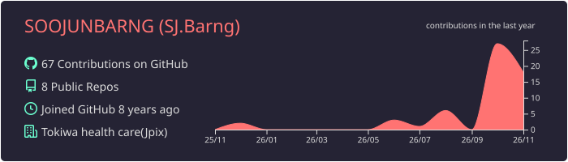
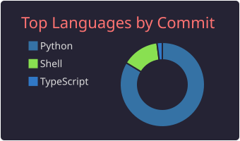
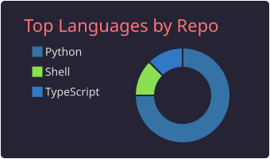
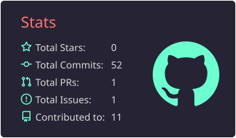
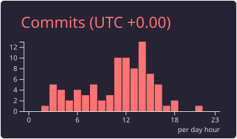

# 🗂️ git_control — SOOJUNBARNG リポジトリ管理

> 最終更新: 2026-11-22 UTC | 合計: 65件

全リポジトリの一覧・管理スクリプトをまとめたハブリポジトリ。**このREADMEは毎日自動更新されます。**

---

## 📊 GitHub Stats

[](https://git.io/streak-stats)

| Overview | Languages |
|----------|-----------|
|  |  |

| Repos per Language | Stats per Language | Productive Time |
|--------------------|--------------------|-----------------|
|  |  |  |

---

## 使い方

```bash
./scripts/status.sh   # 全リポジトリの状態確認
./scripts/pull_all.sh  # 全リポジトリを最新に更新
./scripts/list.sh      # リポジトリ一覧を表示
```

---

## リポジトリ一覧 (65件)

### 🏥 医療・病院 (9件)

| リポジトリ | 公開 | 説明 | 最終更新 | リンク |
|-----------|------|------|----------|--------|
| OCR_based_financial_data_analysis_task | 🔒 | 病院・介護施設の請求書PDF（12社対応）から品名・数量・単価・金額・病棟を自動抽出。Gemini 2.5 Flash による会社識別＋専用プロンプト2段階処理。 | 2026-09-30 | [link](https://github.com/SOOJUNBARNG/OCR_based_financial_data_analysis_task) |
| Data_for_receipt | 🔒 | レセプト処理パイプライン ＋ Streamlit経営分析ダッシュボード（医師別収益性など） | 2026-09-13 | [link](https://github.com/SOOJUNBARNG/Data_for_receipt) |
| KJM_GAS_electricity_water_result_task | 🔒 | GAS: 電気・水道使用量の集計結果をフロア別PDF化してメール送信。clasp + GitHub Actionsで自動デプロイ | 2026-09-11 | [link](https://github.com/SOOJUNBARNG/KJM_GAS_electricity_water_result_task) |
| Analysis_receipt_er_task | 🔒 | 電子カルテ 環境設定更新ログを用いた機器別使用頻度分析 \| 117台×8ヶ月の月次集計・低頻度端末・部署別分析をExcel出力 | 2026-09-04 | [link](https://github.com/SOOJUNBARNG/Analysis_receipt_er_task) |
| READ_PDF_Count_doctor_request_pdf_task | 🌐 | 投薬依頼書（スキャンPDF）から 患者情報・依頼医師・薬品明細 を Gemini OCR で自動抽出し、Excel に整理するパイプラインです。 | 2026-08-26 | [link](https://github.com/SOOJUNBARNG/READ_PDF_Count_doctor_request_pdf_task) |
| Yolov10_task | 🔒 | YOLOv10 + MediaPipe を使って PC カメラ映像からリアルタイムに業務状況を検出するシステムです。 | 2026-08-24 | [link](https://github.com/SOOJUNBARNG/Yolov10_task) |
| KJM_building_electricity_check_product | 🔒 | ESP32 + Firebase で構築した7フロアビル向け電力監視システム。Modbus RTU でスマートメーターからデータ取得し、Web ダッシュボードで可視化。 | 2026-07-30 | [link](https://github.com/SOOJUNBARNG/KJM_building_electricity_check_product) |
| Jpix_ocr_task | 🔒 | 財務諸表PDFを表抽出/OCRでExcel・Wordに変換するツール(Tkinter GUI + CLIスクリプト) | 2026-07-21 | [link](https://github.com/SOOJUNBARNG/Jpix_ocr_task) |
| Medical_frontier_code | 🔒 | これは房の個人レポジトリーではあるが、すべて会社の資産であり個人での利用を厳禁する。 | 2026-07-18 | [link](https://github.com/SOOJUNBARNG/Medical_frontier_code) |

### 🤖 AI・自動化 (13件)

| リポジトリ | 公開 | 説明 | 最終更新 | リンク |
|-----------|------|------|----------|--------|
| AI_make_music_make_product | 🔒 | — | 2026-11-14 | [link](https://github.com/SOOJUNBARNG/AI_make_music_make_product) |
| GCP_IAM_COST_CONTROL | 🔒 | GCP/Firebaseの支払い状況を項目別に把握しプロジェクトをローカルGitリポジトリに紐づけて一覧できるダッシュボードツール。 | 2026-11-09 | [link](https://github.com/SOOJUNBARNG/GCP_IAM_COST_CONTROL) |
| ekispert-multimodal-mcp-product | 🔒 | 🚃 電車×シェアサイクル通勤ナビ \| 駅すぱあと×LUUP×ドコモ×Hello Cycling。住所入力対応。シェアサイクルが電車より速い場合はおすすめ表示。Agentic AI Hackathon Vol.5 | 2026-10-13 | [link](https://github.com/SOOJUNBARNG/ekispert-multimodal-mcp-product) |
| Claude_base_spread_sheet_ppt_google_doc_MCP | 🔒 | Claude との会話を Google Sheets / Docs / Slides に直接書き込む個人用 MCP サーバー。コピペ不要、新規ファイル作成不要。10ツール稼働中。 | 2026-10-01 | [link](https://github.com/SOOJUNBARNG/Claude_base_spread_sheet_ppt_google_doc_MCP) |
| Safe_lending_money_product | 🔒 | 友人に貸したお金が返ってこない → AIが少額訴訟の準備を3分で完了。2エージェント対話で不足書類を特定、Geminiが契約書を即時生成。Vertex AI × Firebase × Flutter｜Google Cloud Japan AI Hackathon Vol.5 | 2026-10-01 | [link](https://github.com/SOOJUNBARNG/Safe_lending_money_product) |
| Google_drive_file_directory_change | 🔒 | 個人のGoogle Driveのファイル・フォルダを自動整理するPythonツール（拡張子/キーワード別振り分け、重複検出、リネーム整形、ドライラン対応） | 2026-09-09 | [link](https://github.com/SOOJUNBARNG/Google_drive_file_directory_change) |
| Claude_base_html_make_MCP | 🌐 | 開発アイデアを構造化してHTML形式で保存するClaude Code用MCPサーバー | 2026-08-21 | [link](https://github.com/SOOJUNBARNG/Claude_base_html_make_MCP) |
| Auto-translation-task | 🔒 | 日本語ファイル（PowerPoint / Word / Excel）を Gemini API で自動翻訳するツール。 | 2026-07-28 | [link](https://github.com/SOOJUNBARNG/Auto-translation-task) |
| auto_contact_form_task | 🔒 | AIでお問い合わせフォームを自動検出・入力する営業自動化ツール（Selenium + Claude API） | 2026-07-21 | [link](https://github.com/SOOJUNBARNG/auto_contact_form_task) |
| Google_ads_control | 🔒 | Google Ads API を使い、月間予算目標に合わせてキャンペーン予算を自動調整するPythonスクリプト | 2026-07-20 | [link](https://github.com/SOOJUNBARNG/Google_ads_control) |
| AI_Voice_bot_netlify | 🔒 | User -> Node.js (このコード) -> Dialogflow CX (Intent) -> 固定の回答 | 2026-07-18 | [link](https://github.com/SOOJUNBARNG/AI_Voice_bot_netlify) |
| PPTAgent_barng | 🌐 | PPTAgent: Generating and Evaluating Presentations Beyond Text-to-Slides | 2025-03-20 | [link](https://github.com/SOOJUNBARNG/PPTAgent_barng) |
| nanobrowser | 🌐 | Open-source Chrome extension for AI-powered web automation. Run multi-agent workflows using your own LLM API key. Alternative to OpenAI Operator. | 2025-03-12 | [link](https://github.com/SOOJUNBARNG/nanobrowser) |

### 🌐 Web・HP (8件)

| リポジトリ | 公開 | 説明 | 最終更新 | リンク |
|-----------|------|------|----------|--------|
| IT_subjob_HP_product | 🔒 | — | 2026-11-15 | [link](https://github.com/SOOJUNBARNG/IT_subjob_HP_product) |
| oasis_seoul_webpage_product | 🔒 | OASIS SEOUL 公式ウェブサイト — ラグジュアリー会員制サービス \| Firebase Hosting + Gemini AI + Firestore | 2026-11-15 | [link](https://github.com/SOOJUNBARNG/oasis_seoul_webpage_product) |
| All_mighty_test_page | 🔒 | ALMIGHTY SQUARE（TOTAL PRODUCE COMPANY）公式サイト — Firebase Hosting + GSAP | 2026-10-01 | [link](https://github.com/SOOJUNBARNG/All_mighty_test_page) |
| web-pitch-demo | 🔒 | ROBUST TRIP 法人海外出張・業務渡航サービスサイト | 2026-09-12 | [link](https://github.com/SOOJUNBARNG/web-pitch-demo) |
| YRC-shukatsu-lab | 🔒 | 外資・日系就活支援Webアプリ｜記事・企業検索・AIエントリシート添削・選考管理 \| Firebase + Gemini 2.5 Flash | 2026-08-22 | [link](https://github.com/SOOJUNBARNG/YRC-shukatsu-lab) |
| Ser_inc_HP | 🔒 | SER株式会社の公式コーポレートサイト — 韓国テクノロジー・文化と日本市場をつなぐ東京拠点の企業（METAX・ヘルスケア・エンターテインメント） | 2026-07-28 | [link](https://github.com/SOOJUNBARNG/Ser_inc_HP) |
| qr_make_task | 🌐 | QRコード生成 & アンケートページ作成ツールキット | 2026-07-28 | [link](https://github.com/SOOJUNBARNG/qr_make_task) |
| Sake_selling_ecshop | 🔒 | 韓国語話者向けの日本酒販売ECサイト（React + Vite + Firebase）。 | 2026-07-18 | [link](https://github.com/SOOJUNBARNG/Sake_selling_ecshop) |

### 📊 データ・分析・スクレイピング (11件)

| リポジトリ | 公開 | 説明 | 最終更新 | リンク |
|-----------|------|------|----------|--------|
| Data_etl_task | 🔒 | 会計データ（摘要テキスト）の構造化ETLパイプライン。ユニーク抽出・カテゴリ分類・人名/業者抽出・LEFT JOIN・集計サマリーまでをPythonスクリプト4本で自動化。 | 2026-11-04 | [link](https://github.com/SOOJUNBARNG/Data_etl_task) |
| SCRAP_help_desk | 🔒 | Doda・Indeedからヘルプデスク求人をスクレイピングしてCSV/JSON保存するツール | 2026-08-31 | [link](https://github.com/SOOJUNBARNG/SCRAP_help_desk) |
| Scrap_data_for_jang | 🔒 | HOUJIN DBから宿泊業・飲食サービス業（業種M）の法人データを一括スクレイピング。約5,600社の事業概要・従業員数・住所等をCSVで取得。中断再開対応。 | 2026-08-11 | [link](https://github.com/SOOJUNBARNG/Scrap_data_for_jang) |
| job_quit_simple_task | 🌐 | 従業員の勤怠・給与データから退職リスクを事前検知するMLパイプライン（ロジスティック回帰・ランダムフォレスト・勾配ブースティング） | 2026-08-08 | [link](https://github.com/SOOJUNBARNG/job_quit_simple_task) |
| suumo_rental_scraper_task | 🔒 | This project scrapes rental property listings from SUUMO, a major Japanese real estate listing site. | 2026-07-22 | [link](https://github.com/SOOJUNBARNG/suumo_rental_scraper_task) |
| address_geo_visualization_task | 🔒 | 住所をジオコーディングし、周辺の行政区域境界と指定半径を地図上に可視化するツール（folium / kepler.gl） | 2026-07-22 | [link](https://github.com/SOOJUNBARNG/address_geo_visualization_task) |
| speech_to_text_analysis_task | 🔒 | 音声データの文字起こし（Whisper + pyannote話者分離）とテキスト分析（キーワード頻度・ワードクラウド・spaCy/GiNZAによる形態素解析）を行うプロジェクト | 2026-07-22 | [link](https://github.com/SOOJUNBARNG/speech_to_text_analysis_task) |
| google-maps-route-optimizer | 🔒 | Google Maps Routes APIを使った複数経由地ルート最適化ツール（CSV/Googleスプレッドシート対応、Leaflet地図出力） | 2026-07-21 | [link](https://github.com/SOOJUNBARNG/google-maps-route-optimizer) |
| data_visualization_task | 🔒 | アソシエーション分析、決定木、地理データマッピング、ネットワークグラフ、サンキーダイアグラム、ウォーターフォールチャートなど、データ可視化・分析手法を試すPythonスクリプト集 | 2026-07-21 | [link](https://github.com/SOOJUNBARNG/data_visualization_task) |
| customer_area_visualization_task | 🔒 | 顧客住所を緯度経度に変換し、埼玉県・東京都エリアでの分布をインタラクティブ地図で可視化するツール | 2026-07-21 | [link](https://github.com/SOOJUNBARNG/customer_area_visualization_task) |
| MA_Techno | 🔒 | 企業リストのスクレイピングを支援するスクリプト集 | 2026-07-21 | [link](https://github.com/SOOJUNBARNG/MA_Techno) |

### 💬 コミュニケーション・LINE (5件)

| リポジトリ | 公開 | 説明 | 最終更新 | リンク |
|-----------|------|------|----------|--------|
| LINE_message_MCP_Product | 🔒 | — | 2026-08-24 | [link](https://github.com/SOOJUNBARNG/LINE_message_MCP_Product) |
| line-works-mcp-server | 🔒 | LINE WORKSをMCP経由で操作するサーバー(メッセージ送信・ユーザー一覧・タスク作成・トーク要約) / MCP server for LINE WORKS — messaging, users, tasks, and talk summaries. Mock data demo. | 2026-08-09 | [link](https://github.com/SOOJUNBARNG/line-works-mcp-server) |
| Google_mail_mcp | 🔒 | Gmail受信トレイを自動整理するPythonスクリプト。ルールベースでラベル付け・アーカイブ・ゴミ箱振り分けを一括処理。 | 2026-09-07 | [link](https://github.com/SOOJUNBARNG/Google_mail_mcp) |
| LINE_TASK_CONTROL | 🔒 | LINE WORKS APIでユーザー一覧取得・タスク作成・一括登録を行うスクリプト集。 | 2026-07-18 | [link](https://github.com/SOOJUNBARNG/LINE_TASK_CONTROL) |
| LINE_LINEWORKS_GAS_SERVER_AI_CHATSERVICE | 🔒 | LINEとLINE WORKSの両方に対応したAIチャットサービス。 | 2026-07-18 | [link](https://github.com/SOOJUNBARNG/LINE_LINEWORKS_GAS_SERVER_AI_CHATSERVICE) |

### 💰 財務・経理 (4件)

| リポジトリ | 公開 | 説明 | 最終更新 | リンク |
|-----------|------|------|----------|--------|
| MF_API_task | 🔒 | — | 2026-11-02 | [link](https://github.com/SOOJUNBARNG/MF_API_task) |
| Financial_evaluation_task_tool | 🔒 | PL/BSベースの企業財務評価を行うためのツール群。 | 2026-07-21 | [link](https://github.com/SOOJUNBARNG/Financial_evaluation_task_tool) |
| Barng_financial_projects | 🌐 | This is a proof of concept for an AI-powered hedge fund (educational purposes only). | 2026-07-18 | [link](https://github.com/SOOJUNBARNG/Barng_financial_projects) |
| Data_upload_and_download | 🔒 | AWSクラウド移行前にデータをTableauで週次・月次で観測するための臨時ツール。 | 2026-07-18 | [link](https://github.com/SOOJUNBARNG/Data_upload_and_download) |

### 🎮 ゲーム・エンタメ・クリエイティブ (7件)

| リポジトリ | 公開 | 説明 | 最終更新 | リンク |
|-----------|------|------|----------|--------|
| Write_novel_product | 🔒 | 결정의 궤적 소설 라이터 — Qwen2.5-7B-Instruct-1M (1M context) で設定集＋本編全文を読み込み次の章を自動生成 / GCP T4対応 | 2026-11-12 | [link](https://github.com/SOOJUNBARNG/Write_novel_product) |
| Global_trading_game_product | 🔒 | 거상처럼 땅을 걸으며 장사를 배우고, 대항해시대처럼 바다를 건너 세계로 나아가는 고양이 교역 게임이에요. | 2026-11-11 | [link](https://github.com/SOOJUNBARNG/Global_trading_game_product) |
| Global_trading_novel_write | 🔒 | — | 2026-11-08 | [link](https://github.com/SOOJUNBARNG/Global_trading_novel_write) |
| Make_image_product | 🔒 | GCP T4 GPU + Pony Diffusion V6 XL로 1610년대 무역항 배경 안트로포모픽 고양이 캐릭터 초상화 생성 (45명) | 2026-11-04 | [link](https://github.com/SOOJUNBARNG/Make_image_product) |
| Make_music_product | 🌐 | ACE-Step 1.5 を GCP の L4 GPU で動かし、要件テキストファイルからゲーム BGM 56 曲を一括生成 (旧 CPU/MusicGen 版は OLD/) | 2026-11-04 | [link](https://github.com/SOOJUNBARNG/Make_music_product) |
| unmei48-product | 🔒 | 運命48 — 四柱推命ベースの縁結びアプリ（Flutter + Firebase）。 | 2026-08-04 | [link](https://github.com/SOOJUNBARNG/unmei48-product) |
| novel-writer-korean | 🌐 | LLMを使った長編小説自動執筆ツール。Claude・GPT・Gemini・Mistral対応。アウトライン→ドラフト→仕上げの3段階で小説を生成します。 | 2026-07-28 | [link](https://github.com/SOOJUNBARNG/novel-writer-korean) |

### 🔧 インフラ・管理・ツール (5件)

| リポジトリ | 公開 | 説明 | 最終更新 | リンク |
|-----------|------|------|----------|--------|
| git_control | 🌐 | SOOJUNBARNG 全リポジトリの一覧・管理ハブ。READMEは毎日自動更新。 | 2026-11-09 | [link](https://github.com/SOOJUNBARNG/git_control) |
| Instagram_own_product | 🔒 | Instagram の投稿を自分のサイトに埋め込むための、セルフホスト型フィードサーバー＆ウィジェット。 | 2026-10-26 | [link](https://github.com/SOOJUNBARNG/Instagram_own_product) |
| filmcraft_python | 🌐 | FilmCraft: An open-source, nonlinear video editor written by scratch in pure Rust | 2026-10-16 | [link](https://github.com/SOOJUNBARNG/filmcraft_python) |
| image_bg_task | 🌐 | ロゴ・ブランド画像の下処理用ツールキット：背景除去、自動クロップ、ICO/SVG変換 | 2026-07-21 | [link](https://github.com/SOOJUNBARNG/image_bg_task) |
| All_general_data_for_barng | 🔒 | 個人資料を整理する個人用アーカイブリポジトリ | 2026-10-25 | [link](https://github.com/SOOJUNBARNG/All_general_data_for_barng) |

### 👤 個人・キャリア (3件)

| リポジトリ | 公開 | 説明 | 最終更新 | リンク |
|-----------|------|------|----------|--------|
| PPT_make_job_hunting_in_japan_product | 🔒 | — | 2026-11-18 | [link](https://github.com/SOOJUNBARNG/PPT_make_job_hunting_in_japan_product) |
| barng-career-site | 🔒 | Soojun Barng's multilingual career/resume site with a Tokiwa Health OKR reporting integration | 2026-10-25 | [link](https://github.com/SOOJUNBARNG/barng-career-site) |
| ai_diary_app | 🔒 | samples, guidance on mobile development, and a full API reference. | 2026-07-21 | [link](https://github.com/SOOJUNBARNG/ai_diary_app) |

### 🏥 はとがや病院グループ (35件) ※コラボレーター

> オーナー: [hatogayait-AX](https://github.com/hatogayait-AX) | 自分はコラボレーターとして参加

| リポジトリ | 公開 | 説明 | 最終更新 | リンク |
|-----------|------|------|----------|--------|
| azuma-jotform | 🔒 | Firebase Hosting上で公開している、患者向けの満足度調査フォーム。 | 2026-11-22 | [link](https://github.com/hatogayait-AX/azuma-jotform) |
| azuma-visit-clinic-hp | 🔒 | あずま在宅クリニック（はとがや病院グループ）公式サイト｜Next.js 15 + microCMS、Firebase Hosting で公開 | 2026-11-22 | [link](https://github.com/hatogayait-AX/azuma-visit-clinic-hp) |
| azuma_care_questionnaire_product | 🔒 | あずま在宅クリニック｜ケアマネジャー向け匿名アンケートサイト（Firebase Hosting + Google Apps Script） | 2026-11-22 | [link](https://github.com/hatogayait-AX/azuma_care_questionnaire_product) |
| Firebase_Hatogaya_voice_product | 🔒 | 医療現場向け音声記録アプリ。録音するだけでAI（Gemini）が文字起こし・要約を自動生成。Firebase Hosting + Cloud Functions で運用。 | 2026-10-28 | [link](https://github.com/hatogayait-AX/Firebase_Hatogaya_voice_product) |
| Google_comment_auto_reply_product | 🔒 | 医療・介護施設のGoogle口コミに、毎日8〜19時の毎正時にGemini Proで返信案を作成し、メールの承認ボタンで投稿するボット（Cloud Run） | 2026-11-22 | [link](https://github.com/hatogayait-AX/Google_comment_auto_reply_product) |
| hatogaya-data-hub-product | 🔒 | 鳩ヶ谷 統合ハブ - シフトマネージャー/jinjer/タレントマネジメント間のデータ連携を集約するFirebase製統合ハブ(MVP開発中) | 2026-11-22 | [link](https://github.com/hatogayait-AX/hatogaya-data-hub-product) |
| hatogaya-it-asset-mgmt-product | 🔒 | 病院内ネットワークの全PC(OS問わず)をpingで自動検出し、WindowsPCのファイル一覧をCSV出力するツール | 2026-11-22 | [link](https://github.com/hatogayait-AX/hatogaya-it-asset-mgmt-product) |
| Hatogaya-medical-chat-bot | 🌐 | — | 2026-10-13 | [link](https://github.com/hatogayait-AX/Hatogaya-medical-chat-bot) |
| Hatogaya_cloud_cost_monitoring_product | 🔒 | はとがや（hatogaya1890it）GCP プロジェクトのクラウドコスト監視ダッシュボード | BigQuery Billing Export → Firestore → Firebase Hosting | 2026-11-22 | [link](https://github.com/hatogayait-AX/Hatogaya_cloud_cost_monitoring_product) |
| Hatogaya_git_control | 🌐 | hatogayait-AX 全リポジトリ一括管理ハブ — GitHub Actions で README を毎週自動更新 | 2026-11-22 | [link](https://github.com/hatogayait-AX/Hatogaya_git_control) |
| hatogaya_hp_product | 🔒 | 医療法人あかつき会 はとがや病院 公式ウェブサイト — 静的HTMLによるリニューアル用ソース（埼玉県川口市） | 2026-10-13 | [link](https://github.com/hatogayait-AX/hatogaya_hp_product) |
| Hatogaya_intranet | 🔒 | はとがや病院 職員ポータル：通達・資料・内部規程・病床稼働率・薬科・チャット・勤怠。Astro + React + Firebase / PWA | 2026-11-22 | [link](https://github.com/hatogayait-AX/Hatogaya_intranet) |
| hatogaya_jobhunting | 🔒 | 医療法人あかつき会（はとがや病院）採用サイト＆人事向け応募者管理システム（Next.js + Supabase） | 2026-10-13 | [link](https://github.com/hatogayait-AX/hatogaya_jobhunting) |
| hatogaya_jotform_product | 🔒 | はとがや病院 患者満足度調査フォーム | 2026-10-13 | [link](https://github.com/hatogayait-AX/hatogaya_jotform_product) |
| Hatogaya_knowledge_share_web_system | 🔒 | 鳩ヶ谷内で使う社内向け知識共有Webシステム(Firebase Cloud Functions + Firestore, Node.js/TypeScript) | 2026-10-13 | [link](https://github.com/hatogayait-AX/Hatogaya_knowledge_share_web_system) |
| hatogaya_nas_cloud_backup_product | 🔒 | 複数NAS(LS220D等)の共有フォルダーをMac経由でGoogle Drive/Boxへ毎日自動バックアップ (rclone + bash + launchd) | 2026-11-22 | [link](https://github.com/hatogayait-AX/hatogaya_nas_cloud_backup_product) |
| Hatogaya_shift_automation_app | 🔒 | シフト自動作成システムへの情報入力・管理Webアプリ。希望休・制約をGoogle Sheetsに登録し、OR-Toolsでシフト自動生成。 | 2026-10-16 | [link](https://github.com/hatogayait-AX/Hatogaya_shift_automation_app) |
| Hatogaya_SLM_product | 🔒 | 病院向けオフライン医療AIアシスタント｜完全ローカル動作・Electron + Ollama + TinySwallow×BioMistral蒸留｜Python不要・ネット不要 | 2026-11-22 | [link](https://github.com/hatogayait-AX/Hatogaya_SLM_product) |
| Hatogaya_talent_management | 🔒 | jinjer × Claude APIで構築した人材管理システム。 | 2026-10-13 | [link](https://github.com/hatogayait-AX/Hatogaya_talent_management) |
| hospital-signage-product | 🔒 | 診察の呼出し状況をリアルタイム表示する、病院向け受付・サイネージシステム。 | 2026-11-22 | [link](https://github.com/hatogayait-AX/hospital-signage-product) |
| Hospital_input_video_page | 🔒 | はとがや病院 電子資料・同意書システム — 入院資料PDF閲覧・オンライン同意書・管理画面。Firebase Hosting + Firestore + GitHub Actions。 | 2026-11-22 | [link](https://github.com/hatogayait-AX/Hospital_input_video_page) |
| LINE_WORKS_SUMMARY | 🔒 | LINE WORKSのトーク履歴をGemini APIで要約し、指定チャンネルに投稿するツール。 | 2026-11-22 | [link](https://github.com/hatogayait-AX/LINE_WORKS_SUMMARY) |
| Medical_information_task | 🌐 | medical-rag-db: ICD-10・DPC・PMDA添付文書を事前埋め込み済みSQLite(rag.db)にまとめ、完全オフラインでRAG検索するための医療知識ベース構築パイプライン | 2026-11-22 | [link](https://github.com/hatogayait-AX/Medical_information_task) |
| Negishi_homecare_HP | 🔒 | 介護老人保健施設「老健ねぎしケアセンター」公式サイト（Firebase Hosting + Cloud Functions） | 2026-11-22 | [link](https://github.com/hatogayait-AX/Negishi_homecare_HP) |
| negishi_survey | 🔒 | 老健ねぎしケアセンター 利用者満足度調査フォーム。回答はGoogle Apps Script経由でスプレッドシートへ保存。 | 2026-11-22 | [link](https://github.com/hatogayait-AX/negishi_survey) |
| saitama-hospital-info-collector | 🔒 | 埼玉県の在宅療養支援診療所・病院データをJMAPから収集し、Gemini APIで要約・特徴タグ付けするパイプライン。 | 2026-11-22 | [link](https://github.com/hatogayait-AX/saitama-hospital-info-collector) |
| Scrap_medical_job_detail_task | 🔒 | job-medley.com から医療系求人データをスクレイピングし Excel に整形するパイプライン（埼玉・東京 / 医師・看護師・PT・OT・ST・薬剤師・訪問看護） | 2026-11-22 | [link](https://github.com/hatogayait-AX/Scrap_medical_job_detail_task) |
| Tokiwa-hatogaya-study-app | 🔒 | — | 2026-10-13 | [link](https://github.com/hatogayait-AX/Tokiwa-hatogaya-study-app) |
| Tokiwa_moneyforward_rpa_product | 🔒 | マネーフォワード クラウドのAPIで仕訳帳CSV（会計）・請求書データを自動取得するスクリプト群 | 2026-11-22 | [link](https://github.com/hatogayait-AX/Tokiwa_moneyforward_rpa_product) |
| AXSawa_meeting-recorder | 🔒 | — | 2026-11-20 | [link](https://github.com/AXSawa/meeting-recorder) |
| bonobonobonono_estimateSimulator | 🔒 | — | 2025-06-11 | [link](https://github.com/bonobonobonono/estimateSimulator) |
| bonobonobonono_Medical_RPA_Project | 🔒 | — | 2025-04-24 | [link](https://github.com/bonobonobonono/Medical_RPA_Project) |
| bonobonobonono_metabase_will_return_to_normal | 🔒 | — | 2025-04-23 | [link](https://github.com/bonobonobonono/metabase_will_return_to_normal) |
| bonobonobonono_PPTGenerator | 🔒 | — | 2025-04-18 | [link](https://github.com/bonobonobonono/PPTGenerator) |
| bonobonobonono_query_practice | 🔒 | — | 2025-04-02 | [link](https://github.com/bonobonobonono/query_practice) |

---

🔒 = プライベート　🌐 = パブリック
